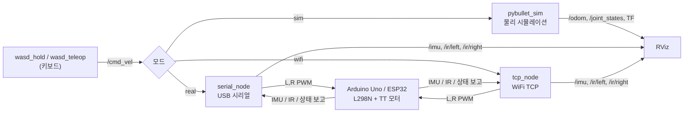

# ROS2 Robot Car & Arm: 2WD 로봇카 · 로봇팔 디지털 트윈 · OpenCV 객체 추적


ROS 2 Jazzy로 만든 소형 로봇 프로젝트 모음입니다.
**시뮬레이션에서 검증한 코드를 노드 하나만 바꿔 끼워 실물 하드웨어에 그대로 쓰는 구조**를 목표로 했습니다.

| 패키지 | 언어 | 내용 |
|---|---|---|
| [`robot_car`](src/robot_car) | Python | 2륜 차동구동 로봇카: URDF, PyBullet 시뮬레이션, WASD 조종, USB 시리얼 / WiFi(TCP) 브리지, IMU·IR 센서 토픽 |
| [`robot_arm`](src/robot_arm) | Python | 4축 SG90 로봇팔 디지털 트윈 (명령 vs 실제 상태 비교), 가상 ToF 센서로 만든 간이 2D LiDAR 스캐너 |
| [`cv_red_center`](src/cv_red_center) | C++ | OpenCV로 웹캠에서 빨간 물체를 검출해 중심 좌표 발행 (런타임 파라미터 변경 지원) |
| [`cv_msg`](src/cv_msg) | msg | 커스텀 메시지 `MsgCenter` (x, y) |
| [`arduino/`](arduino) | C++ (Arduino) | 로봇카 모터 펌웨어: Arduino Uno 버전, ESP32 버전 (WiFi, 자이로 직진 보정, IR 정지, 워치독) |
| [`tools/build_robot.py`](tools/build_robot.py) | Python | YAML 치수 설정 → URDF·파라미터 자동 생성 + 배치 검사 + PyBullet 주행 테스트 |

---

## 1. robot_car: 2WD 차동구동 로봇카



### 주요 설계

- **sim ↔ 실물 교체 구조**: `/cmd_vel` 인터페이스와 운동학 코드(`kinematics.py`)를 시뮬레이터와 실물 노드가 함께 씁니다. 시뮬레이션에서 확인한 계산이 그대로 실물에 들어갑니다.
- **설정 한 곳에서 모델 생성**: 실측 치수를 `config/robot_layout.yaml`에 적으면 `tools/build_robot.py`가 URDF와 `robot_params.py`를 생성합니다. 부품 간섭 검사와 PyBullet 주행 테스트도 함께 실행합니다.
- **차동구동 운동학**: `(v, ω)` → 좌/우 바퀴 각속도. 한쪽이 최대 속도를 넘으면 두 바퀴를 같은 비율로 줄여 회전 반경을 유지합니다.
- **통신 방식만 바꿔 끼우기**: 유선(`/dev/ttyUSB0`)과 무선(TCP, mDNS `robot-car.local`)이 같은 텍스트 프로토콜 `"L,R\n"`을 씁니다. ESP32 스케치 하나로 둘 다 지원합니다.
- **안전장치**
  - 명령이 0.5초 끊기면 정지합니다. PC 노드, 펌웨어, `esp_timer` 독립 워치독 세 곳에서 확인합니다.
  - IR 장애물 센서가 감지하면 ESP32가 직접 전진만 막습니다. WiFi 지연과 상관없이 즉시 멈춥니다.
  - 가속을 제한하고, 반대 방향으로 바꿀 때는 0을 거칩니다. 순간 전류로 인한 brownout 재부팅을 막기 위해서입니다.
  - 재부팅 원인(BROWNOUT/WDT/PANIC)을 PC로 보고해 ROS 로그에 경고로 띄웁니다.
- **자이로 직진 보정**: MPU-6050 DMP의 yaw로 직진 중 틀어진 방향을 PD 보정합니다. `heading_kp`/`heading_kd`를 launch 인자로 조절해 보정을 켜고 끈 상태를 비교할 수 있습니다.
- **누르는 동안만 움직이는 조종**: 터미널은 '키를 뗐다'는 이벤트를 받을 수 없어서 tkinter 창으로 key press/release를 받습니다. 자동 반복으로 생기는 가짜 release는 디바운스로 걸러냅니다.

### 발행 토픽

| 토픽 | 타입 | 출처 |
|---|---|---|
| `/odom`, TF `odom → base_link` | `nav_msgs/Odometry` | pybullet_sim |
| `/joint_states` | `sensor_msgs/JointState` | pybullet_sim |
| `/imu`, `/imu/yaw_deg`, `/imu/heading_hold` | `Imu`, `Float32`, `Bool` | ESP32 → serial/tcp_node |
| `/ir/left`, `/ir/right` | `sensor_msgs/Range` | ESP32 → serial/tcp_node |

### 하드웨어

ESP32 DevKit (또는 Arduino Uno) · L298N 모터 드라이버 · TT 기어모터 ×2 · MPU-6050 (GY-521) · FC-51 IR 센서 ×2 · 볼 캐스터

---

## 2. robot_arm: 로봇팔 디지털 트윈 + ToF 스캐너

```
/command/joint_states (슬라이더 GUI 또는 arm_scanner)
        │
        ▼
 [ros_arm_bridge] ── "a90b90c90d90e" ──▶ Arduino ──▶ SG90 ×4
        ▲                                   │
        └──────── "s90.0,90.0,90.0,90.0" ◀──┘
        │
        ▼
 /joint_states → RViz '실제' 모델     /arm/tracking_error (명령 − 실제)
```

- **명령과 실제를 함께 표시**: RViz에 명령 자세(반투명 고스트, `cmd/*` TF)와 실제 자세(진한 모델)를 겹쳐 그려 추종 오차를 눈으로 볼 수 있습니다.
- **모드 자동 전환** (`mode:=auto`): 시리얼 장치가 있으면 실물을, 없으면 펌웨어와 같은 속도 제한 모델로 시뮬레이션합니다. 장치를 연결하면 자동으로 전환합니다.
- **펌웨어**: 서보를 목표 각도로 한 번에 보내지 않고 정해진 속도로 이동시킵니다. 마지막 자세는 EEPROM에 저장해 부팅할 때 팔이 튀지 않게 했습니다.
- **ToF 스캐너** (`arm_scanner` + `tof_sim`)
  - base 관절을 왕복 회전시키면서 각 스텝의 거리를 모아 `/scan`(LaserScan)과 `/tof/points`(PointCloud2)를 발행합니다.
  - 가상 VL53L0X는 TF로 센서 자세를 구해 광선-상자 교차로 거리를 계산합니다. 측정 범위 0.03–1.2 m, 시야각 25°, 노이즈 모델을 흉내 냅니다.

---

## 3. cv_red_center: OpenCV 빨간 물체 추적 (C++)

웹캠 프레임을 HSV로 변환하고 빨강의 두 Hue 구간(0–10, 170–180)을 마스킹합니다. 가장 큰 컨투어의 중심을 `cv_msg/MsgCenter`로 `red_center` 토픽에 발행합니다.
HSV 임계값은 `config/params.yaml`에서 정하며, `ros2 param set`으로 실행 중에 바꿀 수 있습니다.

---

## 빌드 및 실행

**환경**: Ubuntu 24.04 · ROS 2 Jazzy · Python 3.12 · OpenCV 4

```bash
# 0) 소스 받기
git clone https://github.com/pth6254/ros2-robot-car-and-arm.git
cd ros2-robot-car-and-arm

# 1) 의존성
sudo apt install ros-jazzy-desktop ros-jazzy-joint-state-publisher-gui libopencv-dev
python3 -m venv --system-site-packages venv
venv/bin/pip install -r requirements.txt

# 2) 빌드 (env.sh: ROS2 + venv + 워크스페이스 활성화, colcon 을 venv python 으로 실행)
source env.sh
colcon build --symlink-install
source install/setup.bash
```

### 실행 예

```bash
# 로봇카: 시뮬레이션 (PyBullet + RViz + 키보드 조종 창)
ros2 launch robot_car display.launch.py

# 로봇카: 실물
ros2 launch robot_car bringup.launch.py                                # ESP32 WiFi (기본)
ros2 launch robot_car bringup.launch.py mode:=real port:=/dev/ttyUSB0  # ESP32 USB
ros2 launch robot_car bringup.launch.py mode:=real                     # Arduino Uno USB

# 로봇카 모델 치수 수정 후 URDF 재생성 + 검사 + 주행 테스트
python3 tools/build_robot.py

# 로봇팔 디지털 트윈 (Arduino 있으면 실물, 없으면 sim)
ros2 launch robot_arm display.launch.py
# 로봇팔 ToF 스캔
ros2 launch robot_arm scan.launch.py

# 빨간 물체 추적
ros2 launch cv_red_center red_center.launch.py
```

### 펌웨어 업로드

| 스케치 | 보드 | 비고 |
|---|---|---|
| `arduino/robot_car_motor` | Arduino Uno | USB 시리얼 전용 |
| `arduino/robot_car_motor_esp32` | ESP32 DevKit | 라이브러리: `MPU6050` (Electronic Cats, I2Cdev 포함) |
| `src/robot_arm/arduino/ros_control` | Arduino Uno | 서보 4개 |

ESP32는 업로드 전에 WiFi 설정 파일을 만들어야 합니다. `wifi_config.h`는 git에 올라가지 않습니다.

```bash
cd arduino/robot_car_motor_esp32
cp wifi_config.example.h wifi_config.h   # SSID / 비밀번호 입력 (2.4GHz)
```

---

## 폴더 구조

```
.
├── arduino/
│   ├── robot_car_motor/          # Uno 모터 펌웨어
│   └── robot_car_motor_esp32/    # ESP32 모터 펌웨어 (WiFi, IMU, IR)
├── src/
│   ├── robot_car/                # 로봇카 (launch, urdf, config, rviz, 노드)
│   ├── robot_arm/                # 로봇팔 (launch, urdf, meshes, config, 노드, 펌웨어)
│   ├── cv_red_center/            # OpenCV C++ 노드
│   └── cv_msg/                   # 커스텀 메시지
├── tools/build_robot.py          # YAML → URDF 생성기 + 검사 + 주행 테스트
├── env.sh                        # 개발 환경 활성화
└── requirements.txt
```

## 라이선스 및 크레딧

[MIT License](LICENSE)

`robot_arm` 패키지의 일부(브리지 노드, display launch, 로봇팔 펌웨어)는 수업 예제 코드(© 2024 JD edu, MIT License)를 바탕으로 확장했으며, 해당 파일의 원 저작권 표기를 유지했습니다.
